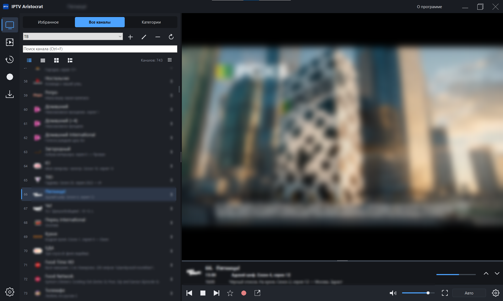
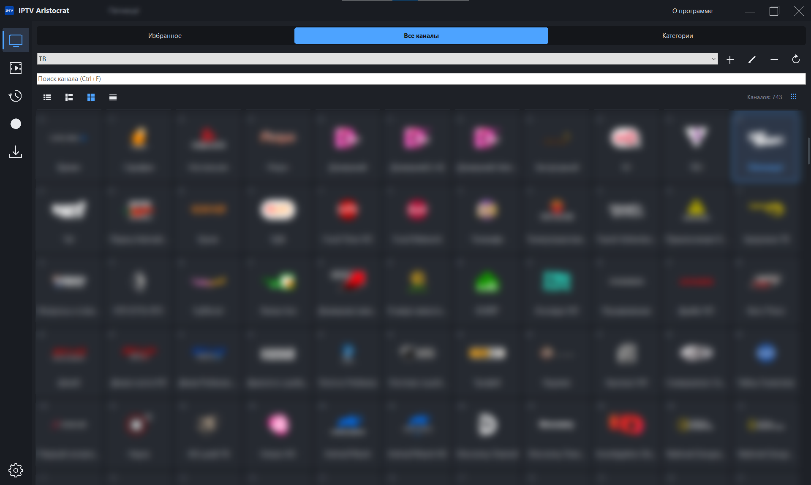
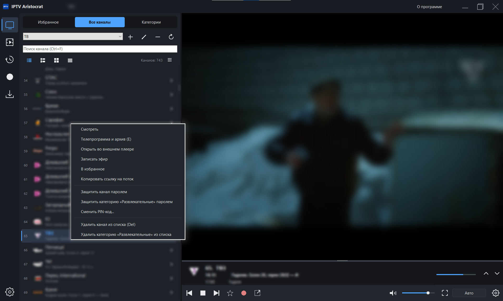
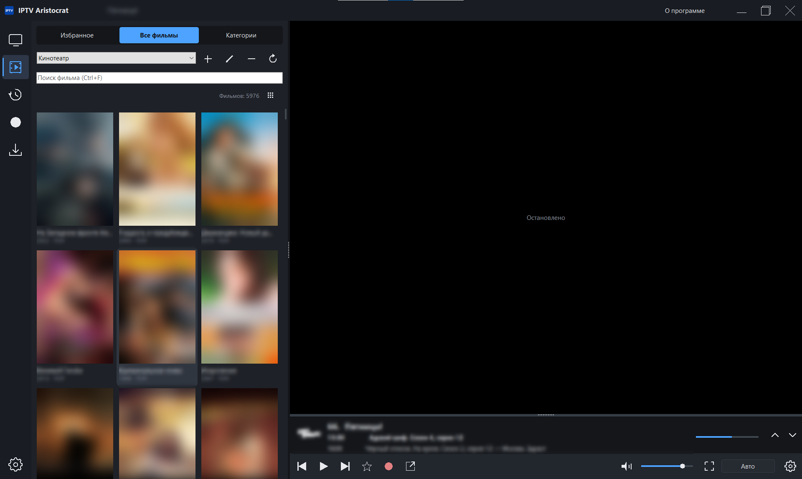
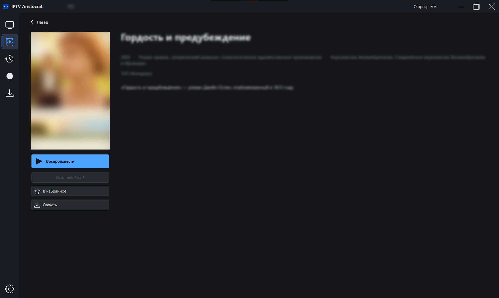
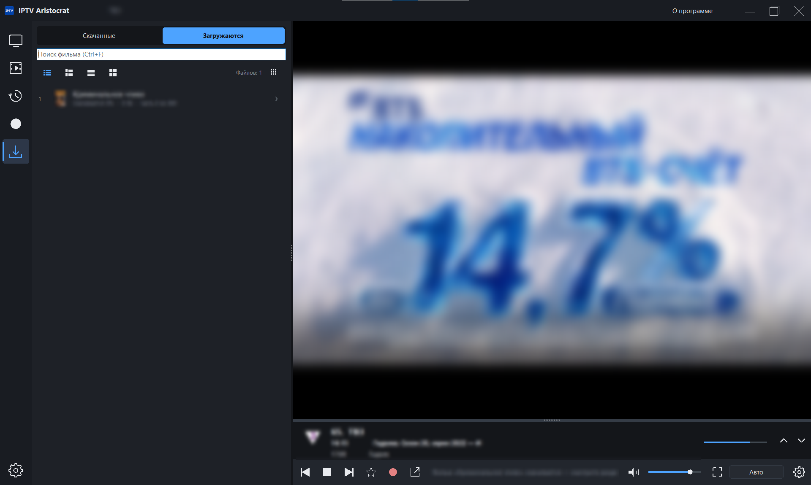
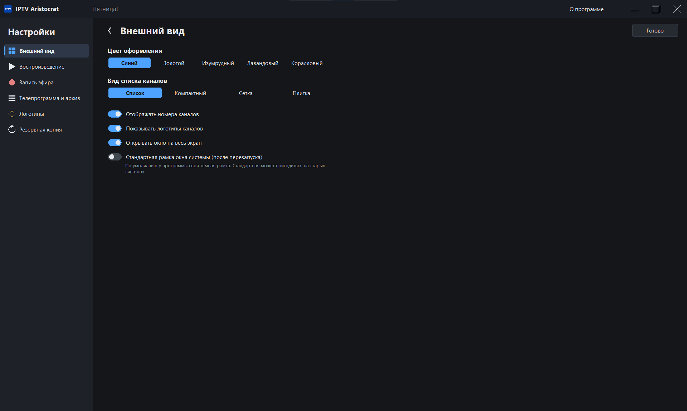
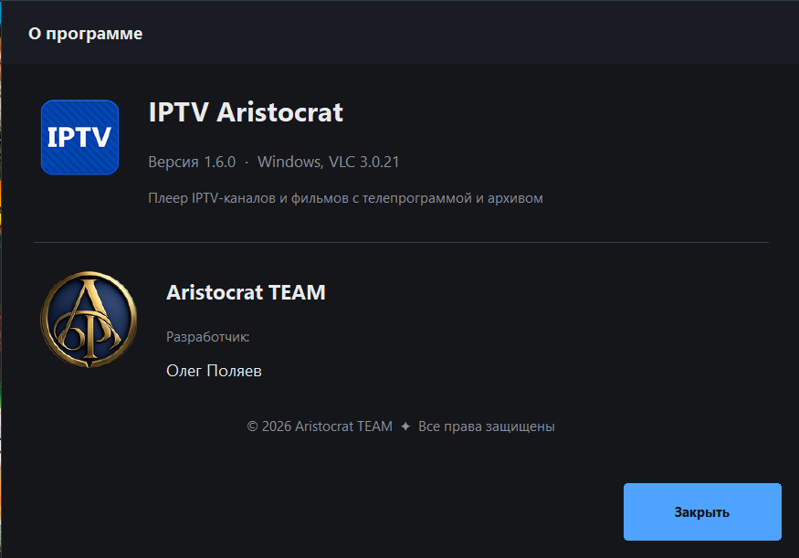

<div align="center">


# IPTV Aristocrat

**Плеер IPTV-каналов и фильмов с телепрограммой, архивом, записью и скачиванием**

Windows XP · Vista · 7 · 8 · 10 · 11 · Linux

Разработчик: **Олег Поляев** · **Aristocrat TEAM**

</div>

---

## Содержание

- [Что это за программа](#что-это-за-программа)
- [Поддерживаемые системы](#поддерживаемые-системы)
- [Что скачать](#что-скачать)
- [Установка](#установка)
- [Первый запуск](#первый-запуск)
- [Возможности](#возможности)
  - [ТВ-каналы](#-тв-каналы)
  - [Телепрограмма и архив](#-телепрограмма-и-архив)
  - [Плеер](#-плеер)
  - [Фильмы (медиатека)](#-фильмы-медиатека)
  - [История](#-история)
  - [Записи эфира](#-записи-эфира)
  - [Скачанные фильмы](#-скачанные-фильмы)
  - [Родительский контроль](#-родительский-контроль)
  - [Удаление каналов из списка](#-удаление-каналов-из-списка)
  - [Логотипы каналов](#-логотипы-каналов)
  - [Настройки](#-настройки)
- [Горячие клавиши](#горячие-клавиши)
- [Мышь](#мышь)
- [Вопросы и ответы](#вопросы-и-ответы)
- [Где хранятся настройки](#где-хранятся-настройки)
- [Об авторах](#об-авторах)

---

## Что это за программа

**IPTV Aristocrat** — плеер для просмотра телеканалов и фильмов из плейлистов M3U,
которые выдаёт ваш IPTV-провайдер. Программа сделана в спокойном тёмном оформлении,
видеоплеер встроен в неё (на основе VLC), поэтому отдельно ничего ставить не нужно.

Коротко о главном:

- 📺 телеканалы списком, сеткой или плиткой, с логотипами и номерами;
- 🗓 телепрограмма и просмотр прошедших передач из архива провайдера;
- 🎬 кинотеатр: фильмы с постерами, описанием, режиссёром и актёрами;
- ⏺ запись эфира и раздел с записями;
- ⬇ скачивание фильмов, чтобы смотреть без интернета;
- 🔒 родительский контроль с PIN-кодом;
- 💾 резервная копия всех настроек в одном файле;
- 🌐 работает и без интернета: сохранённые плейлисты, телепрограмма и логотипы показываются сразу.

### Как это выглядит

> Названия, логотипы каналов, постеры и кадры на снимках размыты — они принадлежат
> телеканалам и правообладателям фильмов.

| ТВ-каналы и плеер | Каналы плиткой |
|:---:|:---:|
|  |  |
| **Меню канала** | **Кинотеатр** |
|  |  |
| **Страница фильма** | **Скачивание фильмов** |
|  |  |
| **Настройки** | **О программе** |
|  |  |

---

## Поддерживаемые системы

| Система | Поддержка | Видеодвижок |
|---|:---:|---|
| Windows XP (SP3), Windows Vista | ✅ | VLC 2.2.8 (последняя версия для XP) |
| Windows 7, 8, 8.1, 10, 11 | ✅ | VLC 3.0 |
| Ubuntu, Linux Mint, Debian | ✅ | VLC из системы (ставится сам) |
| Fedora, openSUSE и другие с RPM | ✅ | VLC из системы |
| Любой 64-битный Linux | ✅ | AppImage, VLC уже внутри |

Программа работает и в виртуальных машинах (VirtualBox, VMware): там она сама
включает совместимый вывод видео.

---

## Что скачать

Готовые файлы лежат на странице **Releases** этого репозитория (или в разделе
**Actions → последняя сборка → Artifacts**).

| Ваша система | Что скачать в релизе |
|---|---|
| Windows XP / Vista | **IPTV Aristocrat (Windows XP)** — установщик<br>**IPTV Aristocrat (Windows XP, без установки)** — архив zip |
| Windows 7 / 8 / 10 / 11 | **IPTV Aristocrat (Windows 7 и новее)** — установщик<br>**IPTV Aristocrat (Windows 7 и новее, без установки)** — архив zip |
| Ubuntu / Mint / Debian | **IPTV Aristocrat (Linux DEB)** |
| Fedora / openSUSE | **IPTV Aristocrat (Linux RPM)** |
| Любой Linux | **IPTV Aristocrat (Linux AppImage)** |

---

## Установка

### Windows

1. Запустите установщик `…-setup.exe`.
2. Отметьте нужные ярлыки: **«Добавить ярлык в меню «Пуск»»** и **«Создать ярлык на рабочем столе»**.
3. Нажмите «Установить». Ярлыки будут называться просто **IPTV**.

**Без установки:** распакуйте zip-архив в любую папку и запустите `IPTV.exe`.

> 💡 **Переносная версия (на флешке).** Создайте в папке программы пустой файл
> `portable.txt` — тогда все настройки будут храниться рядом с программой.

Удалить программу: «Панель управления → Программы» (или «Параметры → Приложения»),
пункт **IPTV Aristocrat**.

### Ubuntu, Linux Mint, Debian

```bash
sudo apt install ./iptv-aristocrat_*_amd64.deb
```

Видеодвижок VLC установится автоматически. Программа появится в меню приложений под именем **IPTV**.

### Fedora

```bash
sudo dnf install ./iptv-aristocrat-*.x86_64.rpm vlc
```

Для VLC нужен подключённый репозиторий RPM Fusion.

### AppImage (любой Linux)

```bash
chmod +x IPTV-Aristocrat-*.AppImage
./IPTV-Aristocrat-*.AppImage
```

Ничего устанавливать не нужно, видеодвижок уже внутри файла.

---

## Первый запуск

При первом запуске программа покажет приветствие с двумя кнопками:

1. **«Добавить плейлист ТВ-каналов»** — вставьте ссылку на плейлист от провайдера
   (`http://…` или `https://…`) или выберите файл `.m3u` / `.m3u8` на компьютере.
2. **«Добавить медиатеку (фильмы)»** — плейлист M3U с фильмами и сериалами. Его можно добавить и позже.

Есть и третий вариант — **«Восстановить из резервной копии»**, если у вас уже есть файл `.aristocrat`.

Телепрограмма подтянется сама, если ссылка на неё указана в плейлисте.

После этого программа всегда запускается одинаково: раздел **«ТВ-каналы» → «Все каналы»**,
список на треть окна, и сразу включается последний просмотренный канал.

---

## Возможности

Слева в окне — панель разделов:

| Значок | Раздел |
|:---:|---|
| 🖥 | **ТВ-каналы** |
| 🎞 | **Фильмы** (медиатека) |
| 🕘 | **История** просмотров |
| ⏺ | **Записи** эфира |
| ⬇ | **Скачанные** фильмы |
| ⚙ | **Настройки** (внизу) |

### 📺 ТВ-каналы

- Три вкладки сверху: **«Избранное»**, **«Все каналы»**, **«Категории»**.
  В «Категориях» сначала показывается список категорий, щелчок открывает каналы категории,
  стрелка «‹» или Backspace возвращает назад.
- **Четыре вида списка** (кнопки над списком): список с текущей передачей, компактный список,
  сетка и плитка.
- **Поиск** по названию канала (Ctrl+F).
- **Несколько плейлистов**: переключаются в выпадающем списке. Кнопки рядом: **+** добавить,
  **✎** изменить, **—** удалить, **⟳** обновить плейлист и телепрограмму.
- **Все каналы на весь экран** (кнопка с сеткой справа над списком или клавиша **G**):
  каналы показываются крупными плитками на всё окно, щелчок по каналу включает его.
- **Избранное**: звёздочка под видео или пункт в меню правой кнопки мыши.

### 🗓 Телепрограмма и архив

- Под видео — текущая и следующая передачи с полосой прогресса. Расписание листается
  колёсиком мыши или стрелками ▲▼ справа: вверх — прошедшие передачи, вниз — будущие.
  Высоту этой панели можно менять, потянув мышью за её верхний край.
- **Полная телепрограмма канала**: стрелка «›» справа от канала, пункт **«Телепрограмма и архив»**
  в меню правой кнопки мыши или клавиша **E**. Передачи разбиты по дням.
- **Архив**: прошедшие передачи с пометкой «смотреть в записи» открываются из архива провайдера.
  Кнопка **«В эфир»** возвращает к прямой трансляции.
  Поддерживаются типы архива `shift`, `append`, `default`, `flussonic` и `xc` (Xtream Codes).
- Телепрограмма берётся из ссылки внутри плейлиста. Свои источники XMLTV (`.xml`, `.xml.gz`)
  добавляются в настройках, можно сразу несколько.

### ▶ Плеер

- Встроенный плеер на основе VLC, каналы переключаются быстро.
- Кнопки под видео: предыдущий канал, стоп/пауза, следующий канал, избранное, запись,
  открыть во внешнем плеере, громкость, полный экран, формат кадра, настройки.
- **Полный экран** (F11, F или двойной щелчок по видео): рамки и панели убираются, остаётся видео.
  Подведите мышь к нижнему краю экрана — появится панель с паузой, перемоткой, громкостью
  и форматом кадра. Через пару секунд она сама спрячется.
- **Формат кадра** (кнопка «Авто» или клавиша **A**): **Авто**, **16:9**, **4:3**,
  **Растянуть на весь экран**, **Заполнить экран** (с обрезкой краёв). Щелчок по кнопке
  переключает на следующий формат, правая кнопка мыши показывает список всех форматов.
- **Перемотка и пауза** для фильмов, записей и архива.
- **Внешний плеер**: при желании каналы можно открывать в VLC, MPC-HC, mpv или любом другом плеере.

### 🎬 Фильмы (медиатека)

- Фильмы показываются **постерами**, как в онлайн-кинотеатрах.
- **Без повторов**: если один фильм встречается в плейлисте много раз (в разных категориях
  и качестве), он собирается в одну карточку с несколькими источниками.
- Вкладки **«Избранное»**, **«Все фильмы»**, **«Категории»** и поиск по названию.
- **Страница фильма** (щелчок по постеру): постер, название, год, жанр, страна, длительность,
  режиссёр, актёры и описание. Описание загружается из открытых источников (Википедия,
  Викиданные, каталог iTunes) и сохраняется на компьютере.
  Под постером — кнопки **«Воспроизвести»**, выбор источника, **«В избранное»** и **«Скачать»**.
- **Двойной щелчок по постеру** сразу запускает фильм.
- Поддерживаются и фильмы-потоки (M3U8/HLS), и обычные файлы (MP4, MKV, AVI…).

### 🕘 История

Последние просмотренные каналы и фильмы — две вкладки, с поиском.

### ⏺ Записи эфира

- **Запись**: красная кнопка под видео, пункт **«Записать эфир»** в меню канала или **Ctrl+R**.
  Записывается канал, который идёт в момент нажатия. Можно переключиться на другой канал,
  запись продолжится.
- Файлы сохраняются в формате `.ts` (открываются любым плеером) в папку, выбранную в настройках.
- В разделе **«Записи»** видны все записи с датой и размером, с поиском. Щелчок включает запись,
  перемотка работает. Правая кнопка мыши: **открыть папку**, **удалить файл** (или клавиша Del).

### ⬇ Скачанные фильмы

- Фильм скачивается кнопкой **«Скачать»** на странице фильма или через меню правой кнопки мыши по постеру.
- Вкладка **«Загружаются»** показывает ход загрузки: проценты, сколько скачано, номер части.
  Одновременно качаются два фильма, остальные ждут в очереди. Загрузку можно отменить,
  а если она сорвалась — нажать **«Скачать заново»**.
- Вкладка **«Скачанные»** — готовые фильмы с названием и постером, они смотрятся без интернета.
- **Качество** (Настройки → Запись эфира): 480p, **720p** (по умолчанию), 1080p или «Лучшее».
  Фильм в 720p обычно весит 1–2,5 ГБ. Если провайдер отдаёт фильм только в одном качестве,
  скачивается оно.
- Фильмы-потоки (M3U8) скачиваются частями и собираются в один файл `.ts`.
- Нельзя скачать только фильмы, зашифрованные провайдером, и прямой эфир — их можно записать.
- Если закрыть программу во время скачивания, она предупредит, что загрузки отменятся.

### 🔒 Родительский контроль

- Правая кнопка мыши по каналу → **«Защитить канал паролем»** или
  **«Защитить категорию «…» паролем»**.
- При первой защите программа попросит придумать **PIN-код** (не короче 4 символов).
- У защищённых каналов в списке нарисован **замок**. PIN-код нужен, чтобы включить канал,
  открыть категорию, посмотреть архив или снять защиту.
- После верного ввода программа не спрашивает код до перезапуска.
- **«Сменить PIN-код»** — в том же меню.

### 🗑 Удаление каналов из списка

- Правая кнопка мыши → **«Удалить канал из списка»** (или клавиша **Del**) или
  **«Удалить категорию «…» из списка»**.
- При обновлении плейлиста удалённое **не возвращается**.
- Вернуть всё сразу — пункт **«Вернуть удалённые каналы»**, или удалите плейлист и добавьте его заново.

### 🖼 Логотипы каналов

- Логотипы загружаются в фоне и сохраняются на диск, поэтому потом показываются даже без интернета.
- Если в плейлисте логотипа нет или он в неудобном формате (SVG, WebP), программа подбирает его
  по названию канала из открытой базы логотипов. Можно задать и свой источник.
- Если логотип не найден, рисуется аккуратный значок с первыми буквами названия.

### ⚙ Настройки

Открываются внутри окна (шестерёнка внизу на панели слева или справа под видео).
Слева разделы, справа их содержимое. Кнопка **«Готово»**, стрелка «‹» или Esc возвращают к просмотру.

| Раздел | Что настраивается |
|---|---|
| **Внешний вид** | цвет оформления (синий, золотой, изумрудный, лавандовый, коралловый), вид списка каналов, номера каналов, логотипы, открытие окна на весь экран, стандартная рамка окна системы |
| **Воспроизведение** | встроенный или внешний плеер и его параметры, автозапуск последнего канала, буфер сети, совместимый вывод видео (для виртуальных машин и старых видеокарт) |
| **Запись эфира** | папка для записей, папка и качество скачанных фильмов |
| **Телепрограмма и архив** | телепрограмма из плейлиста, свои источники XMLTV, сколько дней прошедшей программы хранить, тип архива по умолчанию |
| **Логотипы** | подбор логотипов по названию, свой источник, очистка сохранённых логотипов |
| **Резервная копия** | сохранить или восстановить все плейлисты, источники, избранное и настройки одним файлом `.aristocrat` |

---

## Горячие клавиши

### Просмотр

| Клавиша | Действие |
|:---:|---|
| **Пробел** | пауза / продолжить (фильм, запись) · стоп / включить (канал) |
| **F11** или **F** | полный экран вкл/выкл |
| **Esc** | выйти из полного экрана · закрыть страницу фильма, настройки или телепрограмму |
| **PgUp / PgDn** | предыдущий / следующий канал |
| **↑ / ↓** (в полном экране) | предыдущий / следующий канал |
| **M** | звук вкл/выкл |
| **A** | следующий формат кадра (Авто → 16:9 → 4:3 → Растянуть → Заполнить) |

### Каналы и списки

| Клавиша | Действие |
|:---:|---|
| **Ctrl+F** | поиск |
| **Стрелки, Enter** | выбор канала в списке или сетке |
| **Backspace** | из категории назад к списку категорий · закрыть телепрограмму |
| **E** | телепрограмма и архив выбранного канала |
| **G** | все каналы на весь экран крупными плитками |
| **Del** | удалить канал из списка (в «Записях» и «Скачанных» — удалить файл) |
| **F5** | обновить плейлист и телепрограмму |

### Запись

| Клавиша | Действие |
|:---:|---|
| **Ctrl+R** | начать / остановить запись эфира |

---

## Мышь

| Действие | Результат |
|---|---|
| Щелчок по каналу | включить канал |
| Двойной щелчок по видео | полный экран вкл/выкл |
| Правая кнопка по каналу | меню: смотреть, телепрограмма и архив, внешний плеер, запись, избранное, копировать ссылку, пароль, удаление |
| Щелчок по постеру | страница фильма |
| Двойной щелчок по постеру | сразу смотреть фильм |
| Колёсико над расписанием | листать передачи |
| Перетаскивание заголовка окна | перемещение окна (двойной щелчок — развернуть) |
| Перетаскивание края окна или разделителей | изменение размеров окна и панелей |

---

## Вопросы и ответы

<details>
<summary><b>Есть звук, но нет изображения</b></summary>

Чаще всего это виртуальная машина или старая видеокарта без ускорения видео.
Откройте **Настройки → Воспроизведение** и включите **«Совместимый вывод видео»**,
затем перезапустите программу. В VirtualBox и VMware на Windows XP и Linux этот режим
включается сам.
</details>

<details>
<summary><b>Плейлист по ссылке https:// не загружается на Windows XP</b></summary>

Windows XP не поддерживает современное защищённое соединение HTTPS. Поэтому на XP
ссылки `https://` автоматически сохраняются как `http://`. Большинство провайдеров отдают
плейлист и так. Если нет — скачайте плейлист на другом компьютере и добавьте его файлом.
</details>

<details>
<summary><b>Некоторые каналы на Windows XP не открываются</b></summary>

На XP используется VLC 2.2.8 — последняя версия, которая работает на этой системе.
Часть современных потоков (например, в формате H.265/HEVC) она не поддерживает.
</details>

<details>
<summary><b>Нет телепрограммы</b></summary>

Проверьте, что в **Настройках → Телепрограмма и архив** включена телепрограмма из плейлиста.
Если провайдер не указал её в плейлисте, добавьте ссылку на XMLTV вручную: её обычно
дают в личном кабинете провайдера.
</details>

<details>
<summary><b>Архив не открывается</b></summary>

Архив должен поддерживать сам провайдер. Если он есть, но не указан в плейлисте,
выберите тип архива в **Настройках → Телепрограмма и архив → Тип архива по умолчанию**.
</details>

<details>
<summary><b>Фильм не скачивается</b></summary>

Если фильм зашифрован провайдером или это прямой эфир, программа об этом скажет.
Такой фильм можно записать: включите его и нажмите **Ctrl+R**.
</details>

<details>
<summary><b>Забыл PIN-код родительского контроля</b></summary>

Закройте программу и в файле настроек `aristocrat.ini` удалите строку `Pin=…` в разделе
`[Parental]`. Где лежит файл — см. ниже.
</details>

<details>
<summary><b>Как перенести всё на другой компьютер</b></summary>

**Настройки → Резервная копия → Сохранить.** На новом компьютере — **Восстановить**
(или кнопка «Восстановить из резервной копии» на экране приветствия).
</details>

---

## Где хранятся настройки

| Система | Папка |
|---|---|
| Windows | `%LOCALAPPDATA%\IPTV` (вставьте эту строку в адресную строку Проводника) |
| Windows (переносная версия) | папка `data` внутри папки программы, если там есть файл `portable.txt` |
| Linux | `~/.config/iptv-aristocrat` |

Сами настройки — в файле `aristocrat.ini`.

Записи эфира и скачанные фильмы по умолчанию сохраняются в папку «Видео»
(`IPTV Aristocrat` и `IPTV Aristocrat Загрузки`). Папки можно поменять в настройках.

---

## Об авторах

<div align="center">

**IPTV Aristocrat**

Разработчик: **Олег Поляев**

**Aristocrat TEAM**

© 2026 Aristocrat TEAM ✦ Все права защищены

</div>
